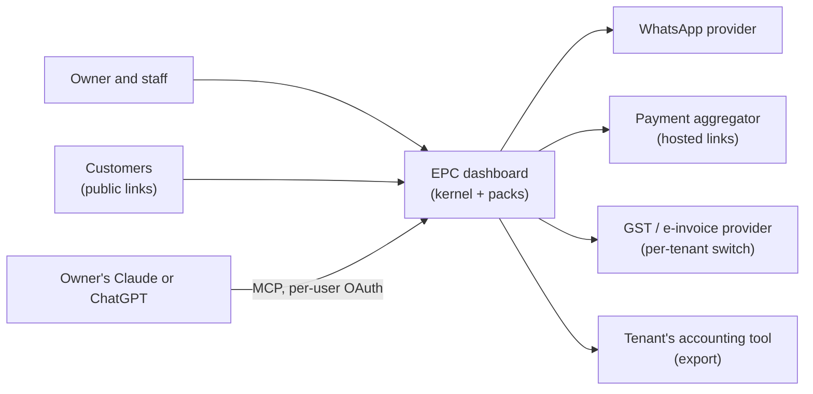
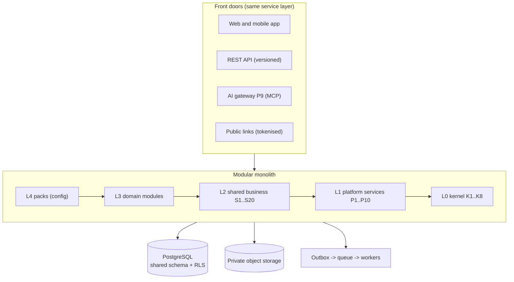
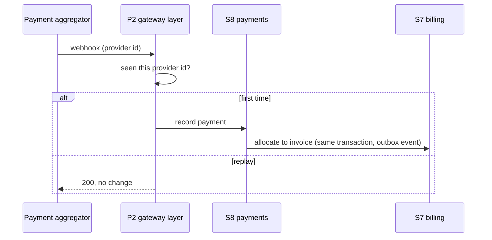
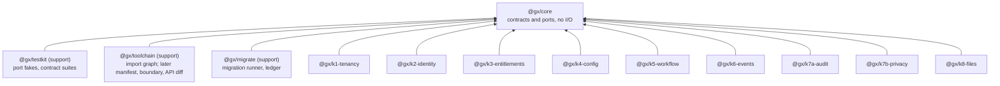

# System design

_Curated. Keep in step with code (skill `gx-system-design`). Generated views: `.claude/map/system-design.html`. Status: design from ADR-0001 to 0005; stack, hosting and repo shape from ADR-0006 (TypeScript on Node.js 24, Next.js on Vercel, Supabase Postgres and Storage in Mumbai, pnpm and Turborepo monorepo). Workspace skeleton built 2026-11-04 (K0-T02)._

## 1. Context


## 2. Containers

Workers run the same code as the app. Side effects (messages, webhooks, PDFs) are asynchronous, never in the request path.

## 3. Key sequences
**Idempotent payment webhook**

**AI tool call (read)**
```mermaid
sequenceDiagram
  participant C as Claude or ChatGPT
  participant P9 as P9 AI gateway
  participant M as Module service
  C->>P9: tool call + user OAuth token
  P9->>P9: tenant, entitlement, permission, admin switch
  P9->>M: same service call as the web app
  M-->>P9: data (RLS applies)
  P9-->>C: masked, untrusted-data output; audit row written
```

## 4. Data ownership
Each module owns its tables (prefix = module id) and exposes an interface and events. No cross-module table reads. Catalog of modules: `module-catalog.md`; contract: `module-manifest.md`.

## 5. Tenancy and security boundaries
Pooled by default: shared schema, `tenant_id` on every table, RLS, tenant set per transaction (ADR-0002). Silo option: same codebase on a dedicated database or region. Compliance rules: `docs/compliance/register.md`. API security: `gx-architecture` security reference.

## 6. Deployment
Indian region (CMP-12): Supabase and Vercel Functions pinned to Mumbai (ADR-0006). One deployable plus workers; pooled production, silo per tenant on demand as a separate Supabase and Vercel project from the same code. Postgres 17 is pinned (ADR-0006 amendment). The Supabase and Vercel projects are configured with placeholders but not created yet; the owner steps are in docs/operations/environments.md.

## 7. Workspace and packages
One monorepo (ADR-0006). `packages/register.json` is the module register: every workspace package, its plan brief and the workspace packages it may depend on. `pnpm check:imports` fails when the register, the `package.json` files and the source imports disagree.



Skeleton stage: every package depends on core only. A module gains a dependency on another (for example K6 on K1) by adding it to its register entry and `package.json` in a small pull request; manifests (K0-T07) and the boundary lint (K0-T08) then enforce layering.

| Rule | Mechanism |
|---|---|
| One public-API file per package | `exports` has one `"."` entry: `@gx/source` condition to `src/index.ts` for typecheck and tests, `types` and `default` to `dist/` for runtime |
| No cross-package internals | The `exports` map blocks deep imports at resolution; the import-graph check reports them with file and line |
| Core has no I/O | Core builds without Node.js type definitions, so `process`, `fs` or `net` fail its build |
| Build order | Turborepo `build` depends on `^build`; typecheck uses the transit-node pattern so a change in core invalidates dependants' cache |
| Ports fail closed | Core defines the nine ports (K0-T14). Modules call the policy ports through `authorize`, `checkEntitlement`, `consumeQuota` and `classifyField`, which turn a throw or a malformed answer into a denial (or `secret`). Each port's fake and contract suite are in `@gx/testkit`, and every real adapter must pass the same suite |
| Logs are redacted in-process | `createLogger(context, { sink })` binds every line to the context's tenant, actor and correlation id. Fields are classified through `classifyField` when the call names an entity, then backstopped by patterns. Core writes only to the `LogSink` port, so the sink never sees raw values (K0-T04) |

| Port | Real adapter |
|---|---|
| `Authorizer` | K2 |
| `EntitlementGate`, `QuotaProvider` | K3 |
| `ClassificationLookup` | K4 (custom fields) |
| `EventPublisher` | K6 outbox |
| `AuditSink` | K7a |
| `EraserRegistry` | K7b |
| `TenantSecretsProvider`, `PlatformSecretsProvider`, `MessageSender` | host adapters (ADR-0006) |

## 8. Change log
- 2026-11-04: initial design from ADR-0001 to ADR-0005
- 2026-11-04: stack from ADR-0006; workspace and packages section for the K0-T02 skeleton
- 2026-11-04: Supabase (Postgres 17, Mumbai) and Vercel (bom1) configured with placeholders
- 2026-11-04: @gx/migrate added (K0-T05): per-package SQL migrations, ledger gx_migrations.ledger, advisory lock
- 2026-11-05: core ports added (K0-T14), with fail-closed guards; fakes and contract suites added to @gx/testkit
- 2026-11-05: after the K0-T14 reviews: secrets split into tenant and platform ports, idempotent quota use, erasure `retained` with basis; a module may not depend on a support package at runtime
- 2026-11-05: redacted structured logging in core (K0-T04): `createLogger` writes to a `LogSink` port; classification first, pattern backstop second; `MemoryLogSink` in @gx/testkit
