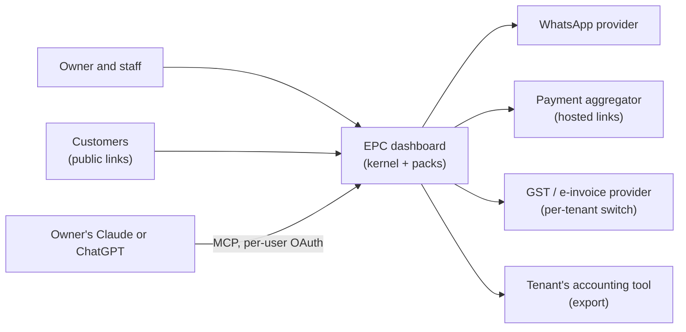
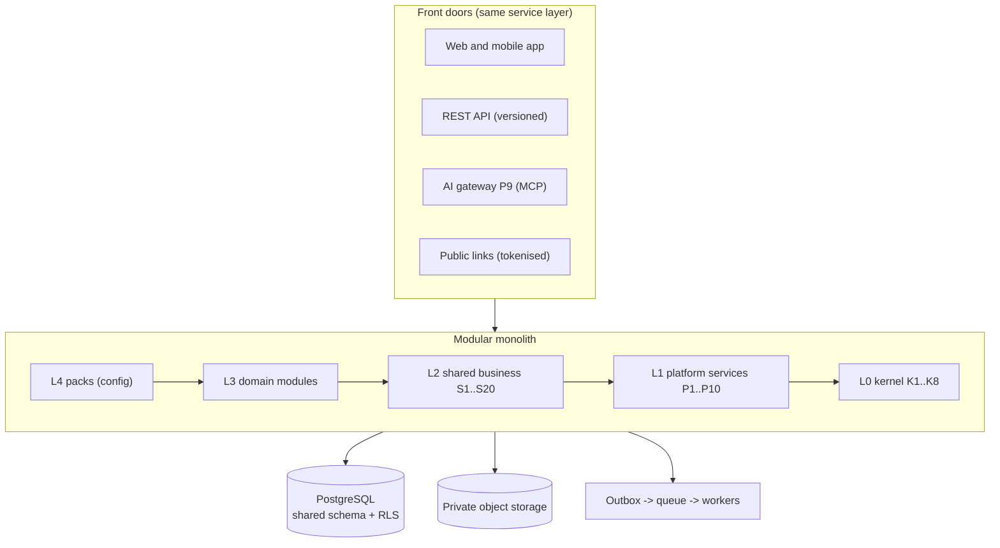
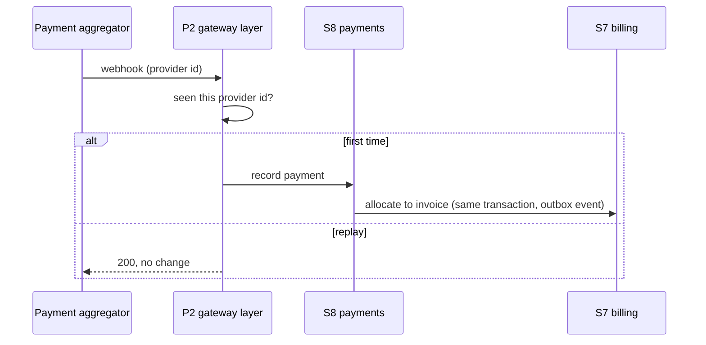

# System design

_Curated. Keep in step with code (skill `gx-system-design`). Generated views: `.claude/map/system-design.html`. Status: initial design from ADR-0001 to 0005, 2026-11-04. Stack (language, framework, hosting vendor) is **not chosen yet**: see `.claude/memory/OPEN_QUESTIONS.md`._

## 1. Context


## 2. Containers

Workers run the same code as the app. Side effects (messages, webhooks, PDFs) are asynchronous, never in the request path.

## 3. Key sequences
**Idempotent payment webhook**

**AI tool call (read)**
```mermaid
sequenceDiagram
  participant C as Claude or ChatGPT
  participant P9 as P9 AI gateway
  participant M as Module service
  C->>P9: tool call + user OAuth token
  P9->>P9: tenant, entitlement, permission, admin switch
  P9->>M: same service call as the web app
  M-->>P9: data (RLS applies)
  P9-->>C: masked, untrusted-data output; audit row written
```

## 4. Data ownership
Each module owns its tables (prefix = module id) and exposes an interface and events. No cross-module table reads. Catalog of modules: `module-catalog.md`; contract: `module-manifest.md`.

## 5. Tenancy and security boundaries
Pooled by default: shared schema, `tenant_id` on every table, RLS, tenant set per transaction (ADR-0002). Silo option: same codebase on a dedicated database or region. Compliance rules: `docs/compliance/register.md`. API security: `gx-architecture` security reference.

## 6. Deployment
Indian region (CMP-12). One deployable plus workers; pooled production, silo per tenant on demand. Infra vendor and stack: open.

## 7. Change log
- 2026-11-04: initial design from ADR-0001 to ADR-0005
